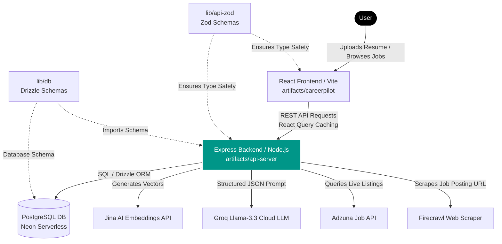

   
    
    
    
    
    
   

  <h1>🚀 AI Career Navigator (CareerOS)</h1>
  
  

    A local-first, modular Career Intelligence Platform designed to automate and optimize the job search lifecycle. It acts as a "Single Source of Truth" for your career, discovering real-time jobs, ranking them semantically, and automatically tailoring your resume for ATS systems without hallucinating facts.
  

  

    <a href="#overview">Overview</a> •
    <a href="#how-it-works">How It Works</a> •
    <a href="#architecture">Architecture</a> •
    <a href="#features">Key Features</a> •
    <a href="#tech-stack">Tech Stack</a>
  

---

## 🌟 Overview

The manual job application process is repetitive and inefficient. Candidates struggle to tailor resumes for varying roles (e.g., Software Engineer vs. AI Engineer) without introducing factual inconsistencies or ruining PDF formatting. 

**AI Career Navigator** solves this. It maintains a structured, verified profile of your skills and experiences. By generating semantic vectors for your profile and live job listings, it mathematically discovers your best matches and uses the **Groq Llama-3.3 Cloud LLM** to surgically inject required keywords into your resume bullet points using the Google/Harvard XYZ framework (`Action Verb + Technology + Metric + Impact`).

---

## ⚙️ How It Works

The system workflow follows a highly structured, data-grounded pipeline:

1. **Resume Ingestion & Structuring:** Upload a raw PDF resume. The system parses the text and uses an LLM to map your data into a strict JSON schema, storing it in PostgreSQL as your verified Career Profile.
2. **Vector Activation:** The system concatenates your career details and sends them to the **Jina AI Embeddings API**, returning a 384-dimensional vector that is saved into PostgreSQL using the `pgvector` extension.
3. **Job Discovery & Scraping:** The app fetches real-time jobs from the **Adzuna API** or scrapes direct URLs using **Firecrawl**, cleaning the job posting into pure markdown.
4. **Semantic Matching:** Background workers generate vectors for newly found jobs. Using PostgreSQL cosine similarity (`<=>`), the app mathematically ranks how closely your profile matches the job requirements (0-100 score).
5. **Resume Tailoring:** The **Resume Studio** uses highly constrained prompts to rewrite your bullet points for a specific job, injecting ATS keywords natively without inventing experiences. 
6. **PDF Generation:** The tailored React component is instantly compiled into an ATS-friendly, downloadable PDF.

---

## 🏗️ Architecture

AI-Career-Navigator utilizes a **Monorepo Architecture** using `pnpm` workspaces. This isolates the React client interface, Express orchestration server, database schemas, and shared TypeScript type validation packages (`Zod`).

### Module Interactions
- **Frontend-Backend Sync:** State caching and network refetching are handled by TanStack React Query.
- **Shared Schemas:** The shared `@workspace/api-zod` package ensures data structures are verified identically on both ends.
- **Database Layer:** The `@workspace/db` package manages connection pooling using Node-Postgres and defines schema configurations for **Drizzle ORM**.
- **AI Orchestration:** The Express backend acts as the controller, coordinating data aggregation from Firecrawl/Adzuna and orchestrating embeddings and text generation via Jina AI and Groq.

---

## ✨ Key Features

- 🧠 **Career Profile Knowledge Base:** Establishes a verified, editable relational profile acting as a single source of truth for your entire career history.
- 🕷️ **Firecrawl URL Scraper:** Strip webpage fluff from any job link into clean markdown to parse exact requirements using Groq.
- 🎯 **Semantic Job Matching:** Ranks jobs mathematically in PostgreSQL using `pgvector` against your profile vector.
- ✍️ **Resume Studio & Tailoring Engine:** Optimizes bullet points dynamically for Applicant Tracking Systems (ATS). It injects job keywords naturally without fabricating experiences.
- 📄 **Interactive Live PDF Preview:** Provides a split-pane HTML view highlighting newly added job keywords, with real-time on-the-fly PDF compilation using `@react-pdf/renderer`.
- 🗄️ **Resume Version Manager:** Archives all previously generated resumes mapped to specific job IDs to maintain history.
- 💡 **AI Career Coach:** Provides sandbox insights for skill gap analyses, market positioning, and recommended courses based on bookmarked job listings.

---

## 🛠️ Technology Stack

### Frontend
- **Framework:** React 19, Vite
- **Routing & State:** Wouter, TanStack React Query v5
- **Styling & UI:** TailwindCSS v4, Framer Motion, shadcn/ui
- **PDF Generation:** `@react-pdf/renderer`

### Backend
- **Framework:** Node.js, Express.js
- **File Processing:** Multer, PDF-Parse
- **Validation:** Zod (Monorepo Shared)
- **Security:** Express-Rate-Limit

### Database & ORM
- **Database:** PostgreSQL (Neon Serverless)
- **Vector Search:** `pgvector` Extension
- **ORM:** Drizzle ORM

### AI & Cloud APIs
- **LLM Engine:** Groq API (`llama-3.3-70b-versatile`)
- **Embeddings:** Jina AI Embeddings API (`jina-embeddings-v3`, 384 dimensions)
- **Web Scraping:** Firecrawl API
- **Job Aggregation:** Adzuna API

---

  
Engineered for the modern tech professional.

